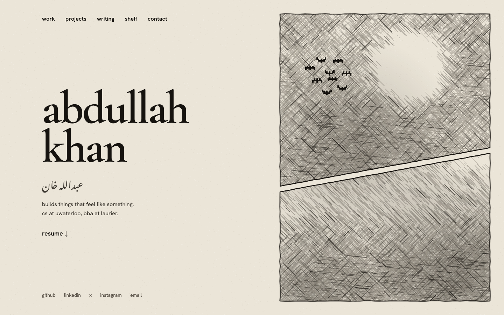

# khanzai.ca

my personal site. paper, ink, and nothing extra.

live at [khanzai.ca](https://khanzai.ca). sister site: [random.khanzai.ca](https://random.khanzai.ca).



## what's on it

- **home** (`/`): name, urdu signature, resume, socials, and the ink panels.
- **work** (`/work`): internships as a timeline, newest first.
- **projects** (`/projects`): what i've built. each one gets its own page at `/projects/[slug]`.
- **writing** (`/writing`): posts written in mdx, with an rss feed at `/writing/rss.xml`.
- **shelf** (`/shelf`): playlists, anime, books, and movies with covers. each section also has its own page at `/shelf/[section]`.
- **contact** (`/contact`): email and socials.
- **404**: one small panel with the moon and two bats, plus a way back home.

## how the homepage works

the right side is one `<canvas>` drawn with plain canvas 2d. no animation libraries.

- **crosshatching**: short ink strokes are drawn at random spots, about 30 times a second. a noise field decides how dense each area gets. the whole layer slowly fades, so the panels keep redrawing themselves and never look the same twice.
- **the moon**: a circle in the top panel where the hatching is set to zero, so it stays clean paper. the hatching gets lighter near its edge.
- **borders**: two panels split by a slanted gutter. the outlines are wobbly, double-stroked lines, so they look inked by hand instead of drawn with a ruler.
- **bats**: 9 pixel bats that flock as boids, meaning they follow simple rules to stay together, line up, and keep some space. they scatter away from your cursor. click the moon and they all blast outward, then drift back together.

the art is drawn on a fixed 1440×900 grid and scaled to fit the screen. under 1024px it turns into a banner under the text, and under 640px the bats are gone. if `prefers-reduced-motion` is on, it draws one frame and stops.

the shared drawing helpers (paper, hatch strokes, fading, inked borders, bat sprites) live in [`lib/ink.ts`](lib/ink.ts). the homepage canvas (`components/InkPanels.tsx`) and the 404 panel (`components/NotFoundPanel.tsx`) both use them.

## stack

- [next.js](https://nextjs.org) 16 (app router) + react 19
- typescript
- tailwind css 4
- canvas 2d for the ink panels
- mdx via `next-mdx-remote` + `gray-matter`
- fonts via `next/font/google`: cormorant garamond, hanken grotesk, noto nastaliq urdu
- `@vercel/analytics`
- deployed on vercel
- pnpm

## editing content

everything lives in `content/`, so changing the site means editing data, not components:

- `work.ts`: the work timeline
- `projects/*.mdx`: one file per project
- `writing/*.mdx`: one file per post
- `shelf.ts`: playlists, anime, books, movies
- `socials.ts`: links used on the homepage and contact page

add `draft: true` to a project's or post's frontmatter to hide it in production. it still shows up in `pnpm dev`.

the full guide is in [`content/README.md`](content/README.md).

## running it locally

```bash
pnpm install
pnpm dev      # http://localhost:3000
pnpm build    # production build
```

## environment variables

all optional. put them in `.env.local`, which stays out of git. the site builds and runs fine without any of them.

| name | what it's for | without it |
|------|---------------|------------|
| `TMDB_API_KEY` | movie posters on `/shelf` | movies show a placeholder card |
| `SPOTIFY_CLIENT_ID` | automatic playlist list from the spotify api, only used when the manual `playlists` list in `content/shelf.ts` is empty | the playlist section is hidden and just the spotify link shows |
| `SPOTIFY_CLIENT_SECRET` | goes with `SPOTIFY_CLIENT_ID` | same as above |
| `NEXT_PUBLIC_SITE_URL` | the site url used for links like the rss feed | defaults to `https://khanzai.ca` |

## credits

shelf covers and data come from:

- [anilist](https://anilist.co): anime and manga covers
- [open library](https://openlibrary.org): book covers
- [tmdb](https://www.themoviedb.org): movie posters
- [spotify](https://open.spotify.com): playlist covers and titles

This product uses the TMDB API but is not endorsed or certified by TMDB.

---

built by [abdullah khan](https://khanzai.ca)
